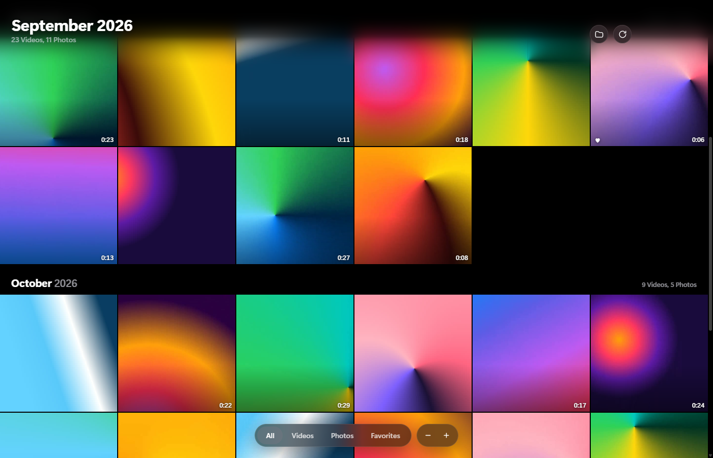
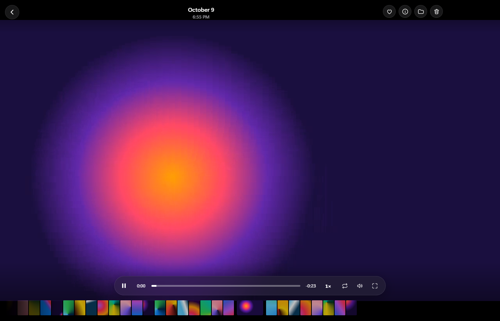

# Clips

**An iPhone Photos-style gallery for your game clips and screenshots on Windows.** Scroll a grid of everything you've recorded, click to open and it plays instantly, then scroll the mouse wheel to flick through clip after clip.

<p align="center">
  
</p>
<p align="center">
  
</p>
<p align="center"><sub>Screenshots use demo clips.</sub></p>

## Download

**[⬇ Download the latest version](../../releases/latest)** and choose one of these:

- **`Clips-Setup-x.x.x.exe`**: the installer. Double-click it and it installs and opens straight away. No admin rights needed.
- **`Clips-x.x.x-portable.zip`**: no installer. Unzip it anywhere and run `Clips.exe`.

> **Windows may show a "Windows protected your PC" warning.** This happens with any app that hasn't paid for a code-signing certificate. Click **More info → Run anyway**.

Windows 10/11, 64-bit.

### Where it looks for clips

On first launch, Clips opens the first of these folders that exists:

1. `Videos\NVIDIA`: NVIDIA ShadowPlay / NVIDIA App (all games)
2. `Videos\Captures`: Xbox Game Bar (`Win + Alt + R`)
3. `Videos\Radeon ReLive`: AMD
4. `Videos`

Use the **folder button** (top right) to pick any other folder, like OBS recordings or Medal clips. Subfolders are included, and new clips show up on their own while the app is open.

### Faster thumbnails (optional)

Clips works on its own, but if [FFmpeg](https://ffmpeg.org) is installed, thumbnails load much faster and are saved for next time. The easiest way to install it is to open a terminal and run:

```bash
winget install Gyan.FFmpeg
```

## Features

**Library**
- Square grid grouped by month, newest at the bottom, like iOS Photos
- The big title follows the month you're scrolling through
- Video lengths on each tile, and **hover a video to preview it**
- Filter **All / Videos / Photos / Favorites**
- Zoom the grid with **− / +** or **Ctrl + scroll**

**Player**
- Opens with the iOS zoom animation and plays right away
- **Scroll the mouse wheel to go to the next or previous clip**
- Seek bar you can drag, play/pause, volume, loop, full screen
- **Slow motion**: 0.25× and 0.5× (plus 1.5× and 2×)
- Frame-by-frame stepping, filmstrip of all your clips along the bottom
- Favorite ♥, info panel, show in folder, delete (moves the file to the Recycle Bin)
- Double-click photos to zoom in, drag to move around

### Keyboard shortcuts

| Key | Action |
|---|---|
| `Space` / `K` | Play / pause |
| `←` `→` | Previous / next clip |
| `Shift + ←` `→` | Skip 5 seconds |
| `J` | Back 10 seconds |
| `,` `.` | Step one frame |
| `0`–`9` | Jump to 0%–90% |
| `S` | Change speed |
| `L` | Loop on/off |
| `M` | Mute |
| `F` | Favorite |
| `I` | Info |
| `Enter` | Full screen |
| `Delete` | Delete (to Recycle Bin) |
| `Esc` | Back to the library |

## Building it yourself

You'll need [Node.js](https://nodejs.org) 20 or newer.

```bash
git clone https://github.com/nickstearl-max/clips.git
cd clips
npm install
npm start          # run in development
npm run dist       # build the installer + portable zip into release/
```

Built with [Electron](https://www.electronjs.org/). Videos are streamed from disk through a custom protocol with range requests, so seeking is instant and nothing is copied.

## License

[MIT](LICENSE)
